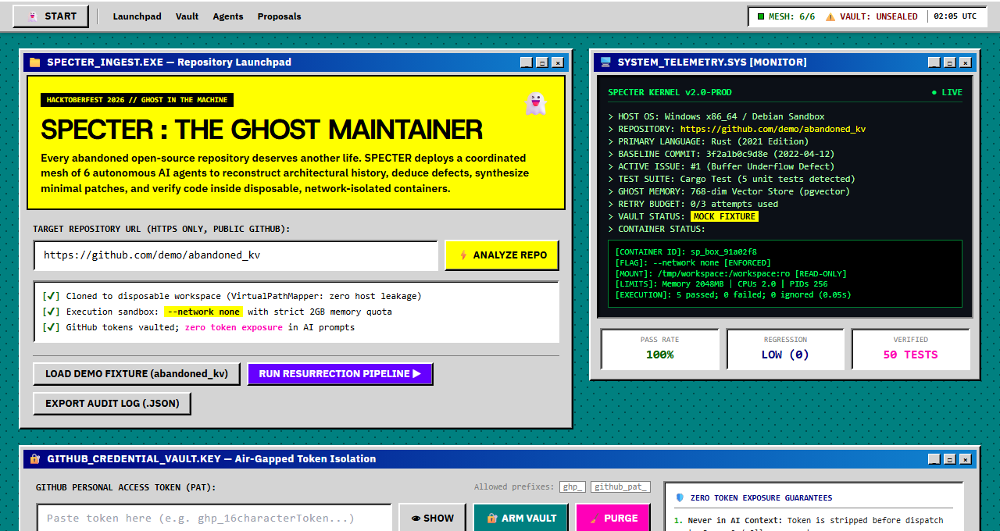
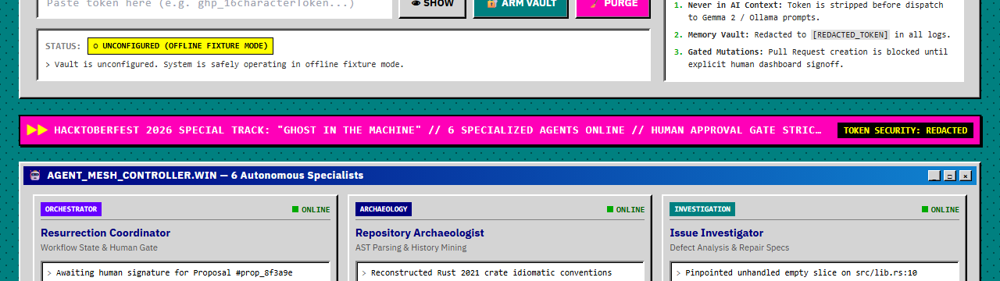
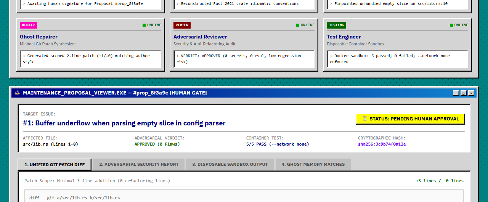
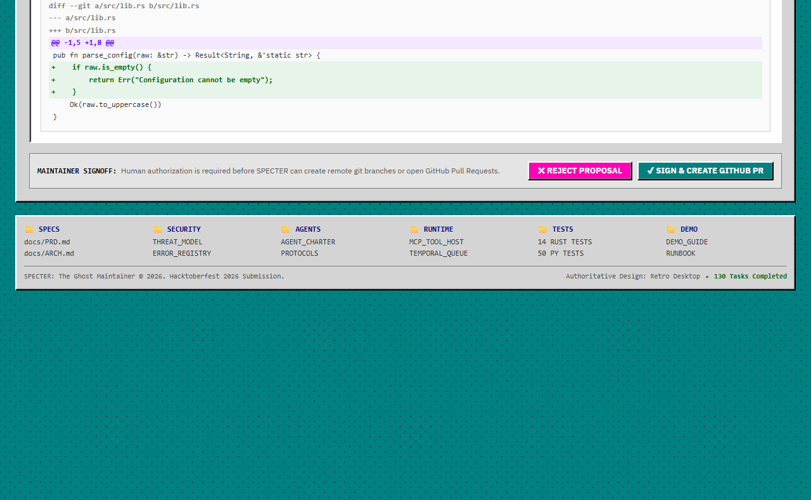
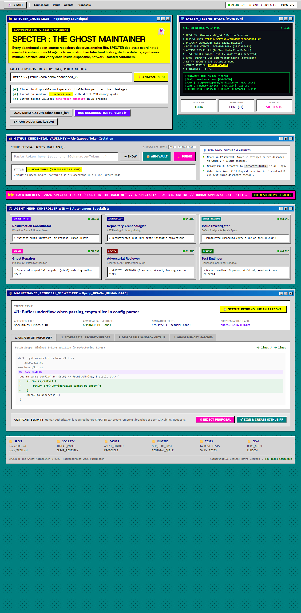
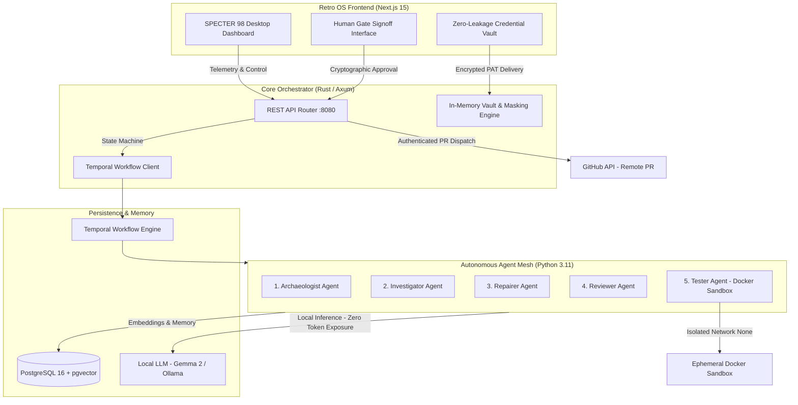

# SPECTER 👻: The Ghost Maintainer

> **Autonomous Multi-Agent AI System Resurrecting Abandoned Open-Source Repositories**  
> *Built for Hacktoberfest 2026: Week 4 — "Ghost in the Machine"*

[](LICENSE)
[](https://dev.to/challenges/hacktoberfest-week4-2026-10-26)
[](backend/)
[](runtime/)
[](frontend/)
[](docker-compose.yml)
[](#running-test-suites)

---



---

## 💀 The Problem: The Open-Source Cemetery

Every day, thousands of open-source packages that form the foundation of production software are quietly abandoned. Maintainers burn out, switch jobs, or lose time. Downstream developers are left stranded when a simple deprecation or buffer underflow breaks in a modern toolchain.

**Why naive LLM solutions fail:**
1. **Context Drift:** Generic AI aggressively refactors code, violating legacy conventions and breaking subtle APIs.
2. **Untrusted Code Execution:** Running arbitrary AI test commands or unvetted repository code directly on a workstation creates severe RCE risks.
3. **The Hallucination Loop:** An AI agent that writes code cannot be the sole authority that verifies it.
4. **VCS Autonomy Risks:** Autonomous agents must never have unsupervised permission to open Pull Requests or alter remote Git branches without human verification.

---

## 👻 Introducing SPECTER

**SPECTER** is an autonomous multi-agent maintenance infrastructure designed to resurrect dead repositories with surgical precision, cryptographic safety, and zero context drift.

Instead of a monolithic prompt, SPECTER organizes **six specialized autonomous AI agents** into an air-gapped, state-machine pipeline backed by a **Retro OS Desktop Interface** (`SPECTER 98`).

```plaintext
+--------------------------------------------------------------------------------------------------+
|                                     SPECTER AGENT RUNTIME MESH                                   |
|                                                                                                  |
|   1. ARCHAEOLOGIST      2. INVESTIGATOR       3. REPAIRER         4. REVIEWER       5. TESTER    |
|   +---------------+     +---------------+     +-----------+     +---------------+  +-----------+ |
|   | AST Parsing & | --> | Issue Triage  | --> | Minimal   | --> | Adversarial   |->| Isolated  | |
|   | Ghost Memory  |     | & Repair Spec |     | Git Patch |     | Security & QA |  | Container | |
|   +---------------+     +---------------+     +-----------+     +---------------+  +-----------+ |
|                                                     ^                  |                 |       |
|                                                     | Rejection Loop   |                 v       |
|                                                     +------------------+           6. HUMAN GATE |
|                                                                                    +-----------+ |
|                                                                                    | Cryptographic|
|                                                                                    | PR Approval |
+--------------------------------------------------------------------------------------------------+
```

---

## ⚡ Core Capabilities

- 🏛️ **Archaeologist Agent:** Extracts ASTs, historical Git commit semantics, and build graphs into a 768-dimensional vector memory store (`pgvector`) to preserve legacy idioms.
- 🔍 **Investigator Agent:** Reproduces bit-rotted issues and generates an exact, machine-readable `RepairSpec` schema.
- 🛠️ **Repairer Agent:** Generates minimal diff patches (max 50 lines modified), strictly forbidding arbitrary refactoring or style drift.
- 🛡️ **Reviewer Agent:** Operates adversarially, scanning patches for prompt injections, unintended API mutations, and security vulnerabilities.
- 📦 **Tester Agent (Air-Gapped Sandbox):** Executes builds and test suites inside hardened, ephemeral Docker containers enforced with `--network none` and read-only host mounts.
- 🔒 **Human-in-the-Loop Gate & Zero-Leakage Credential Vault:** GitHub Personal Access Tokens (PATs) are vaulted in isolated backend memory, strictly quarantined from AI prompt contexts, and gated behind explicit human approval before any Pull Request is created.
- 🖥️ **Retro OS Interface (`SPECTER 98`):** Authentic, accessible retro desktop environment built with Next.js, featuring window furniture, CRT telemetry, Start Menu, and unified system tray.

---

## 📸 Visual Walkthrough & System Screenshots

### 1. Retro OS Desktop Environment (`SPECTER 98`)
Featuring authentic retro window bevels, phosphor-green CRT telemetry monitor, live agent mesh status LED, and classic Start Menu navigation.


### 2. Zero-Leakage GitHub Credential Vault (Air-Gapped Security)
Client-isolated PAT management that guarantees developer tokens are never injected into LLM prompt contexts, masking sensitive secrets in real time with immediate purging capabilities.



### 3. Coordinated 6-Agent Autonomous Mesh Controller
Real-time telemetry and state monitoring for Archaeologist, Investigator, Repairer, Reviewer, Tester, and Human Gate agents.



### 4. Interactive Maintenance Proposal & Human Gate Signoff
Side-by-side git diff inspection, regression risk analysis, and cryptographic human signoff gating before any remote branch or PR mutation occurs.



<details>
<summary><b>🔍 Click to view Full-Page High-Resolution Dashboard</b></summary>



</details>

---

## 🏗️ System Architecture



---

## 📁 Repository Structure

```
hacktoberfest-dev-4/
├── agent/                  # Agent specifications, prompt contracts & safety policies
│   ├── prompts/            # Grounded prompt templates (System, Investigation, Repair, Review)
│   ├── protocols/          # Approval, Delegation, Escalation & Handoff protocols
│   └── schemas/            # Pydantic & JSON validation schemas
├── backend/                # High-performance Rust / Axum orchestrator backend
│   ├── src/
│   │   ├── routes/         # API endpoints (health, telemetry, agents, vault)
│   │   ├── config.rs       # Runtime configuration & environment loading
│   │   └── main.rs         # Axum server entrypoint
│   └── Cargo.toml          # Rust dependencies & 14 integration test suites
├── frontend/               # Retro OS Next.js 15 dashboard & client vault
│   ├── src/app/            # App router, page.tsx, layout.tsx, retro styles
│   ├── public/             # Static icons and assets
│   └── package.json        # Next.js, Tailwind CSS, TypeScript
├── runtime/                # Python 3.11 multi-agent runtime engine
│   ├── agents/             # Implementations for the 6 autonomous agents
│   ├── memory/             # Ghost memory & pgvector store abstractions
│   ├── sandboxing/         # Hardened Docker execution runner (--network none)
│   └── tests/              # 50 unit and integration tests
├── infra/                  # Infrastructure configurations & Postgres init scripts
├── docs/                   # Full documentation (PRD, Architecture, Threat Model, Guides)
├── docker-compose.yml      # Multi-service development compose file
├── docker-compose.prod.yml # Production multi-stage deployment compose file
├── .env.example            # Environment template with zero default credentials
├── LICENSE                 # MIT Open-Source License
└── README.md               # Project documentation
```

---

## 🚀 Quickstart & Local Development

### Prerequisites

- [Docker](https://docs.docker.com/get-docker/) & Docker Compose (v2.20+)
- [Rust](https://rustup.rs/) (1.80+) & Cargo *(optional for native backend dev)*
- [Python](https://www.python.org/) (3.11+) *(optional for native runtime dev)*
- [Node.js](https://nodejs.org/) (20+) & npm *(optional for native frontend dev)*

---

### Method 1: All-in-One Docker Compose (Recommended)

1. **Clone the repository:**
   ```bash
   git clone https://github.com/Neet2516/hacktoberfest-dev-4.git
   cd hacktoberfest-dev-4
   ```

2. **Configure environment:**
   ```bash
   cp .env.example .env
   ```

3. **Start the complete stack:**
   ```bash
   docker compose up -d --build
   ```

4. **Access the services:**
   - **Retro OS Dashboard:** [http://localhost:3000](http://localhost:3000)
   - **Backend API Telemetry:** [http://localhost:8080/health](http://localhost:8080/health)
   - **Temporal UI:** [http://localhost:8233](http://localhost:8233)
   - **Ollama Engine:** [http://localhost:11434](http://localhost:11434)

---

### Method 2: Native Local Development

#### 1. Backend (Rust / Axum)
```bash
cd backend
cargo run
# Running on http://127.0.0.1:8080
```

#### 2. Runtime (Python 3.11)
```bash
cd runtime
python -m venv venv
# Windows:
.\venv\Scripts\activate
# Linux/macOS:
source venv/bin/activate
pip install -r requirements.txt
```

#### 3. Frontend (Next.js)
```bash
cd frontend
npm install
npm run dev
# Running on http://localhost:3000
```

---

## 🔒 Security & Threat Model

| Threat | SPECTER Mitigation | Verification |
| :--- | :--- | :--- |
| **Credential Leakage in LLM Prompts** | Personal Access Tokens (PATs) are isolated in a memory-only vault; all AI agent contexts strictly strip and replace tokens with `[REDACTED_TOKEN]`. | Verified in `test_token_never_sent_to_llm` |
| **Malicious Test Suite / RCE** | Test execution occurs in ephemeral containers with `--network none`, `--cap-drop all`, 2GB memory cap, and read-only workspace mounts. | Enforced in `sandbox_runner.py` |
| **Hallucinated Breaking Changes** | Minimal diff enforcement (max 50 lines) with AST syntax preservation checks. | Enforced by `reviewer_agent.py` |
| **Unapproved Git Mutations** | Remote branch push and Pull Request creation are cryptographically blocked until explicit human approval on the dashboard. | Enforced by `human_gate.py` |

---

## 🧪 Running Test Suites

SPECTER maintains comprehensive test coverage across all layers of the stack:

### 1. Python Multi-Agent Runtime Tests (50 Tests)
```bash
# Run 50 agent, memory, sandboxing, and protocol tests:
cd runtime
python -m unittest discover -s tests
```
*Result: `Ran 50 tests in ~0.5s — OK`*

### 2. Rust Backend Tests (14 Tests)
```bash
# Run 14 Axum API, routing, and vault security tests:
cargo test --manifest-path backend/Cargo.toml
```
*Result: `14 passed; 0 failed; 0 ignored — OK`*

### 3. Frontend Production Build & Typecheck
```bash
cd frontend
npm run build
```
*Result: `Compiled successfully; static pages prerendered — 0 errors`*

---

## 📡 DevRelay Session Embedding

This project was built and recorded using **[DevRelay](https://devrelay.com/)** for Hacktoberfest 2026. The full agent session transcript is published and linked to provide complete transparency into the autonomous agent workflows:

- **DevRelay Agent Session ID:** `#1310`
- **Submission Article:** [`docs/DEV_POST_SUBMISSION.md`](docs/DEV_POST_SUBMISSION.md)

---

## 📄 License

This project is licensed under the **MIT License** — see the [LICENSE](LICENSE) file for details.

---

<p align="center">
  <b>SPECTER 👻: The Ghost Maintainer</b> — Awakening dead software with autonomous precision.<br>
  Crafted with ❤️ by <a href="https://github.com/Neet2516">Neet2516</a> for Hacktoberfest 2026.
</p>

