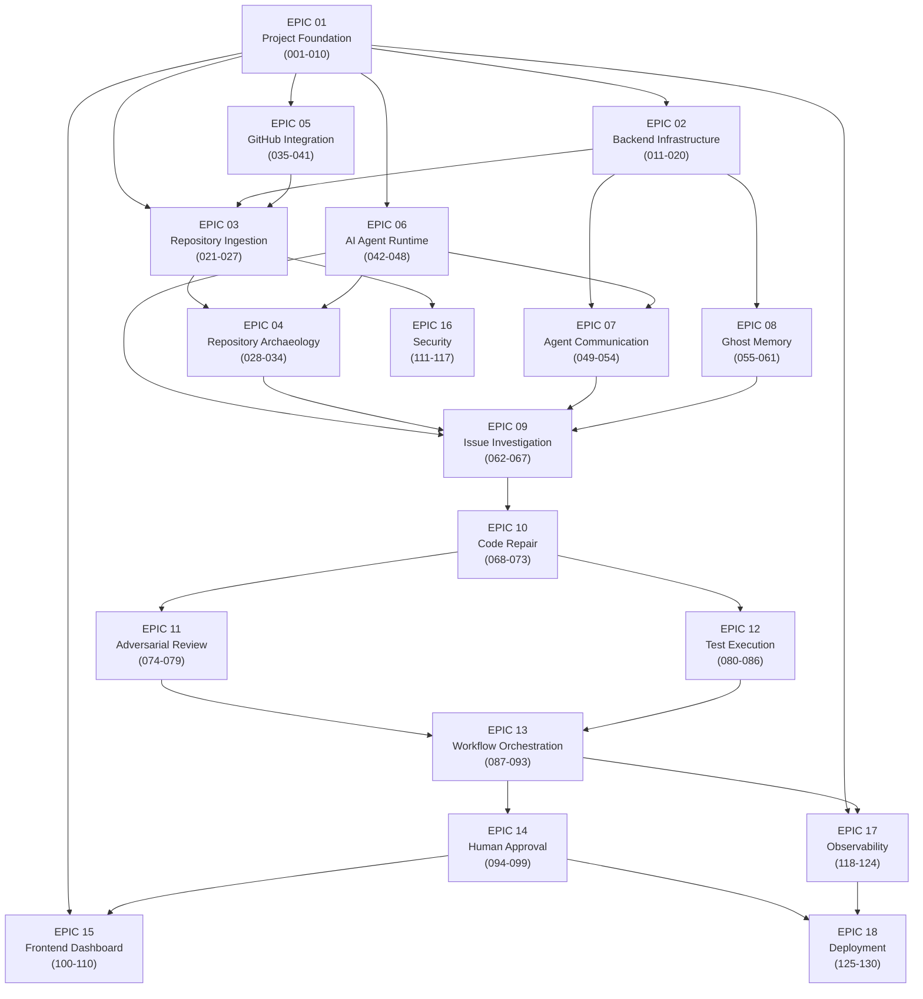
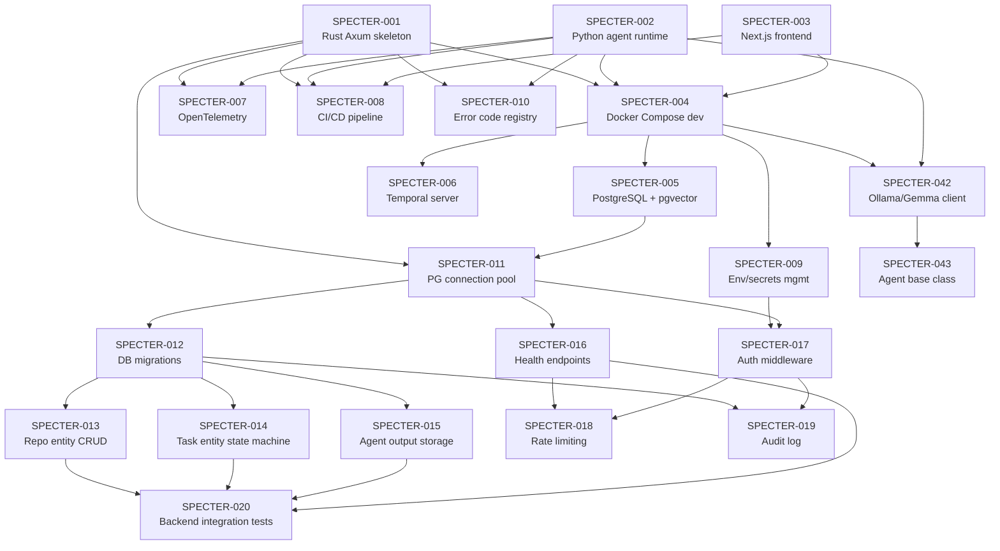
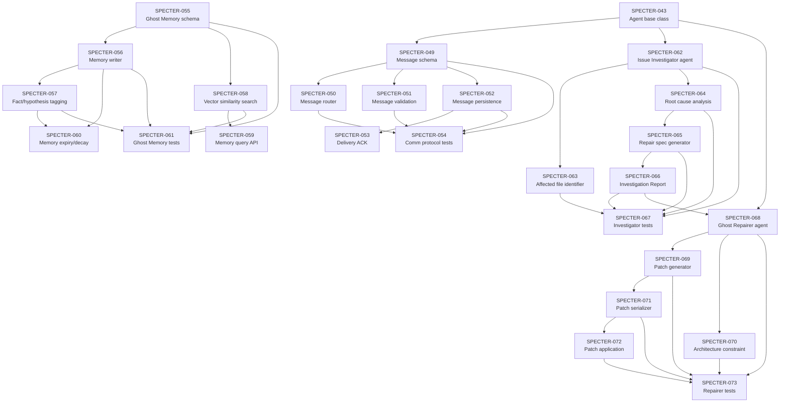
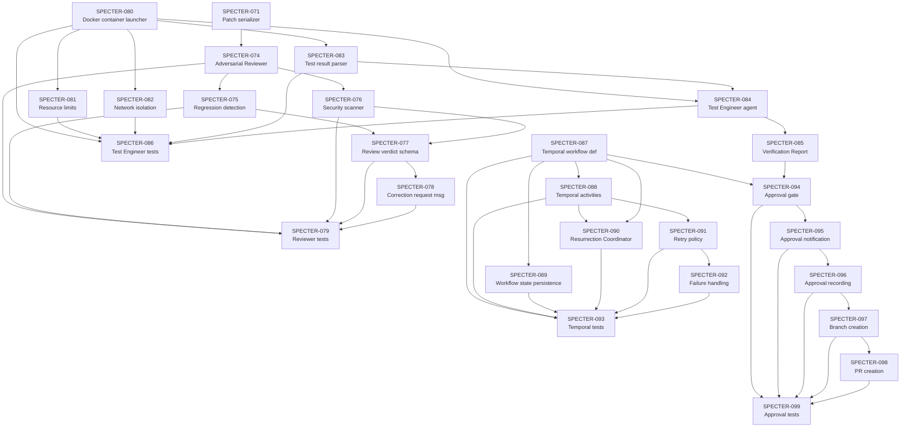

# SPECTER Dependency Graph

> Visual representation of all task dependencies, epic groupings, critical path, and parallel execution tracks.

---

## Legend

```
[SPECTER-NNN] ──► [SPECTER-MMM]   Task NNN must complete before MMM can start
════════════════                   Critical path segment
── ── ── ──                        Soft dependency (recommended order, not blocking)
```

---

## High-Level Epic Dependency Flow



---

## Critical Path

The **critical path** is the longest chain of sequential dependencies. Any delay on the critical path delays the entire project.

```
SPECTER-001 ──► SPECTER-005 ──► SPECTER-011 ──► SPECTER-012
    ──► SPECTER-013 ──► SPECTER-024 ──► SPECTER-023
    ──► SPECTER-028 ──► SPECTER-032 ──► SPECTER-033
    ──► SPECTER-042 ──► SPECTER-043 ──► SPECTER-062
    ──► SPECTER-065 ──► SPECTER-066 ──► SPECTER-068
    ──► SPECTER-069 ──► SPECTER-071 ──► SPECTER-072
    ──► SPECTER-074 ──► SPECTER-077 ──► SPECTER-087
    ──► SPECTER-088 ──► SPECTER-090 ──► SPECTER-094
    ──► SPECTER-096 ──► SPECTER-097 ──► SPECTER-098
```

**Estimated sequential depth:** 19 hops from project start to first GitHub PR.

---

## Parallel Execution Tracks

These tracks can proceed independently once EPIC 01 is complete:

### Track A — Backend + Database (sequential core)
```
001 → 005 → 011 → 012 → 013/014/015 → 016 → 017 → 018/019 → 020
```

### Track B — Frontend (parallel with backend)
```
003 → [wait for 016 API] → 100 → 101 → 102 → 103 → 104 → 105 → 106 → 107 → 108 → 109 → 110
```

### Track C — Agent Runtime + AI (parallel with backend)
```
002 → 042 → 043 → 044/045/046/047 → 048
                 ↓
              049 → 050/051/052/053 → 054
```

### Track D — Repository Pipeline (needs Track A + C)
```
021 → 022 → 023 → 024/025/026 → 027
028 → 029/030/031 → 032 → 033 → 034
```

### Track E — GitHub Integration (parallel, needs 009)
```
040 → 035 → 036/037 → 041
```

### Track F — Agent Pipeline (needs Track C + D)
```
062 → 063/064 → 065 → 066 → 067
068 → 069 → 070/071 → 072 → 073
074 → 075/076 → 077 → 078 → 079
080 → 081/082 → 083 → 084 → 085 → 086
```

### Track G — Orchestration (needs Track F)
```
087 → 088 → 089/090/091 → 092 → 093
094 → 095 → 096 → 097 → 098 → 099
```

### Track H — Security (runs alongside every track)
```
111 (with 021)
112 (with 042)
113 (with 080)
114 (with 082)
115 (with 043)
116 (with 040)
117 (final security gate)
```

### Track I — Ghost Memory (parallel with Track D)
```
055 → 056 → 057/058 → 059/060 → 061
```

### Track J — Observability (parallel with Track G)
```
007 → 118 → 119/120 → 121 → 122/123/124
```

### Track K — Deployment + Docs (last)
```
125 → 126/127/128 → 129 → 130
```

---

## Detailed Dependency Graph — EPIC 01–06



---

## Detailed Dependency Graph — EPIC 07–10



---

## Detailed Dependency Graph — EPIC 11–14



---

## Parallel Track Summary (Gantt-style ASCII)

```
WEEK →          W1      W2      W3      W4      W5      W6      W7      W8
Track A (BE)   [001-010][011-020]
Track B (FE)   [003    ]               [100-110................................]
Track C (AI)           [042-048][049-054]
Track D (Repo)                  [021-027][028-034]
Track E (GH)   [040    ][035-041]
Track F (Agts)                          [062-079][080-086]
Track G (Orch)                                          [087-093][094-099]
Track H (Sec)  [══════════════════ Security runs alongside all tracks ══════]
Track I (Mem)                  [055-061]
Track J (Obs)          [007    ]                                [118-124]
Track K (Doc)                                                           [125-130]
```

---

## P0 Task Cluster (Must Complete First)

These tasks form the **non-negotiable foundation**. No other work can begin safely without them:

```
SPECTER-001  Initialize Rust Axum API service skeleton
SPECTER-002  Initialize Python agent runtime package
SPECTER-003  Initialize Next.js + TypeScript frontend project
SPECTER-004  Configure Docker Compose for development environment
SPECTER-005  Set up PostgreSQL with pgvector extension
SPECTER-006  Configure Temporal server and worker connection
SPECTER-009  Configure environment variable management and secrets handling
SPECTER-011  Implement PostgreSQL connection pool in Rust
SPECTER-012  Implement database schema migrations
SPECTER-017  Implement API authentication middleware
SPECTER-025  Implement file system isolation
SPECTER-040  Implement GitHub token secure storage
SPECTER-076  Implement security issue scanner
SPECTER-082  Implement network isolation for test containers
SPECTER-111  Implement URL sanitization for repository inputs
SPECTER-112  Implement secret scanning before AI prompt injection
SPECTER-113  Implement Docker host mount restrictions
SPECTER-114  Implement container network isolation enforcement
SPECTER-116  Implement GitHub token vault integration
```
